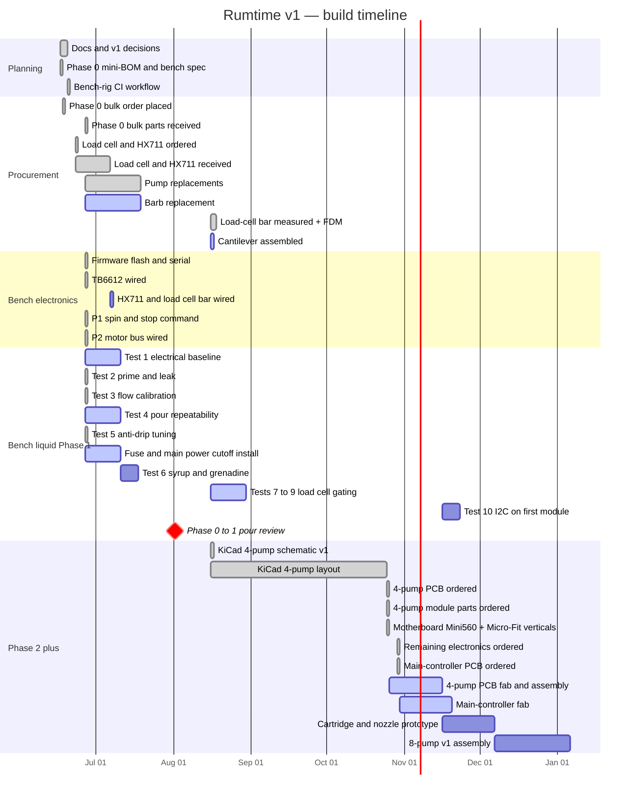

# Project Timeline

Living Gantt and procurement log for Rumtime v1. Update after bench sessions, orders, and phase gates.

Reference: [`09-build-plan-and-verification.md`](09-build-plan-and-verification.md), [`14-bench-test-protocol.md`](14-bench-test-protocol.md).

**Last updated:** 2026-10-29 (main-controller PCB ordered; barbed unions deferred).

## Gantt chart

**Legend:** `done` = verified in repo or bench log; `active` = started, not complete; unmarked future bars = planned (dates are estimates until Phase 1 exit).

## Milestones

| Date       | Milestone                                      | Evidence |
| ---------- | ---------------------------------------------- | -------- |
| 2026-06-17 | Project repo and v1 hardware docs              | Initial commit |
| 2026-06-17 | Phase 0 decisions locked (KPHM100, TB6612, S3) | `12-phase-0-decisions.md` |
| 2026-06-17 | Bench-rig firmware tree added                  | `firmware/bench-rig/` |
| 2026-06-18 | Phase 0 bulk parts ordered (mini-BOM)          | Operator |
| 2026-06-20 | Bench-rig CI (PlatformIO build)                | `.github/workflows/` |
| 2026-06-23 | Load cell bar + HX711 ordered (same shipment)  | Operator |
| 2026-06-27 | Phase 0 bulk parts received (scale kit pending) | Operator |
| 2026-06-27 | Session 01 — TB6612 + P1 bring-up (no scale yet) | `bench-results/2026-06-27-session-01.md` |
| 2026-06-27 | Session 02 — P1+P2 @ 1.75 ml/s, anti-drip 100 ms | `bench-results/2026-06-27-session-02.md` |
| 2026-06-27 | 2× 24 V pumps returned; smooth couplers return **pending** (1.8 mm ID, on hand) | Operator |
| 2026-07-12 | Session 03 — product FW/kiosk pour (open-loop), cancel, Wi‑Fi disconnect stop | `bench-results/2026-07-12-session-03.md` |
| 2026-07-12 | Session 04 — HX711 MCU wired (GPIO 8/9); load cell bar pending | `bench-results/2026-07-12-session-04.md` |
| 2026-07-18 | 8× correct 12 V HB pumps on hand; 2× wrong 24 V pumps returned | Operator |
| 2026-07-19 | Session 05 — four-pump CAD coupons: mount holes pass; walls→2 mm; Ø32/Ø3.3; clamp silicone pending | `bench-results/2026-07-19-session-05.md` |
| 2026-08-16 | Session 06 — load-cell bar measured (75 mm, M4 tapped); bench cleat/pad/pins printing | `bench-results/2026-08-16-session-06.md` |
| 2026-08-16 | Session 07 — cantilever assembled (not measured); 4-pump schematic v1 ERC-clean; PCB silkscreen in progress | `bench-results/2026-08-16-session-07.md` |
| 2026-08-20 | Session 08 — load cell soldered + `scalecal 374.76`; Test 7.1 pass; Tests 7.2–9 deferred | `bench-results/2026-08-20-session-08.md` |
| later      | Tests 7.2–9 (glass / vibration / flow-gate)            | Deferred 2026-08-20 — **not** a 4-pump PCB gate |
| 2026-10-25 | 4-pump module PCB ordered (OSH Park, 3 boards) | Operator |
| 2026-10-25 | 4-pump module parts ordered (AliExpress equivalents) | Operator |
| 2026-10-25 | Motherboard + module AliExpress batch (Mini560, Micro-Fit V/RA, F1, terminals, passives) | Operator |
| 2026-10-29 | Remaining electronics: 1×8 sockets, Micro-Fit F–F harness, USB-C 6P, SS14, LEDs, 300 Ω | Operator |
| 2026-10-29 | Main-controller PCB ordered for fab | Operator |
| TBD        | Test 10 (I2C on first module)                  | Post-fab bring-up — **not** a Gerber gate |
| TBD        | First drink from 8-pump v1                     | Phase 4 exit |

## Bench session log (timeline)

| Date       | Session | Focus |
| ---------- | ------- | ----- |
| 2026-06-27 | 01      | Firmware, TB6612, P1 dry spin (scale not wired) |
| 2026-06-27 | 02      | Water prime, flow cal, P2, anti-drip, Test 4b partial |
| 2026-07-12 | 03      | Product controller + kiosk: open-loop pour, cancel, disconnect stop (no scale) |
| 2026-07-12 | 04      | HX711 ↔ ESP32 (3.3 V / GND / DT=8 / SCK=9); load cell bar not soldered |
| 2026-07-19 | 05      | Four-pump CAD coupons: mount pattern pass; thin walls + Ø32/Ø3.3; clamp silicone pending |
| 2026-08-16 | 06      | Load-cell bar calipers (75×12.75, holes 5/15/59/69, M4 tap); cleat/pad/pins FDM |
| 2026-08-16 | 07      | Cantilever assembled (not measured); schematic v1 ERC-clean; PCB silkscreen |

## Procurement log

Fill **ordered** and **received** as you go. Sourced from [`13-phase-0-mini-bom.md`](13-phase-0-mini-bom.md).

| Item | Qty ordered | Received | Status | Notes |
| ---- | ----------: | -------- | ------ | ----- |
| KPHM100-HB-B10 pump (12 V) | 10 cumulative | 2026-07-18 | **8 on hand / 2 returned** | The **8 on hand** are correct 12 V HB units. Seller previously shipped **2× 24 V** variants; both were returned. Only **P1+P2** have been bench-validated so far. |
| Pololu TB6612FNG #713 | 4 | 2026-06-27 | OK | **1** on bench (P1+P2); **3** spare — enough for 4-pump bench / Test 10 without reorder |
| ESP32-S3-DevKitC-1 | 1 | 2026-06-27 | OK | N16R8 on bench; 8 MB flash profile |
| Mean Well GST60A12-P1J (12 V 5 A) | 1 | 2026-06-27 | OK | Interim: bench DC supply also in use |
| 3×5 mm FDA silicone tubing | 2 rolls × 5 m | 2026-06-27 | OK | **10 m** total; 3×5 mm class (caliper waived — fit OK on bench) |
| PP barb unions (Quickun B08L5DTRCK class) | 1 set | 2026-06-27 | **Wrong SKU — return pending** | Shipped as **smooth silicone couplers** (slip join, not barbed). **Not yet returned** (post office pending). Operator measured **1.8 mm ID** bore vs **3 mm** line tubing. **Not** a barb union; on outlet (tube in one end, pour from other) narrows orifice vs open 3 mm tube. Food-contact rating not verified. Sessions 01–02 used **open ~3 mm outlet** (no restriction at tip). |
| Spring clamps | 1 set | 2026-06-27 | OK | |
| Inline fuse + main power cutoff | 1 | 2026-06-27 | OK | Not installed yet |
| Estardyn 5 kg load cell bar + HX711 | 1 set | on hand | **OK (cal)** | Session 08: soldered, `scale_ready`, **`scalecal 374.76`**. Test 7.1 pass; 7.2–9 deferred. |
| Graduated cylinder (250 ml) | 1 | 2026-06-27 | OK | In use session 02 |
| Breadboard + jumpers | 1 | 2026-06-27 | OK | |
| MCP23017 breakout | 1 | — | **skip** | Not buying. Test 10 is first assembled module (2026-08-20). |
| 4-pump module parts | 1 set | — | **ordered 2026-10-25 / 29** | Oct 25: MCP23017-E/SO, 10 kΩ, 100 nF, Micro-Fit RA 2×3, F1 1812-2A, JST-XH 2-pin 5-set. Oct 29: plain female **1×8** sockets; extra JST-XH 2-pin 5-set. |
| Motherboard power / bus / sockets | see notes | — | **ordered 2026-10-25** | Mini560 **5 V** ×2; Micro-Fit vertical 6-pin; KF301-5.0-2P ×10; 2.2 kΩ; 1×22 / 1×6 / 1×4 (DevKit + HX711). |
| Motherboard remainder + harness | see notes | — | **ordered 2026-10-29** | USB-C **6P** top-mount class; **SS14** Schottky; 3 mm LED kit; **300 Ω** 0805 (LED_STATUS); Micro-Fit **43025** housings + **pre-crimped F–F leads** (DIY home-runs for ~3 modules). |

**Order dates:** Bulk mini-BOM **2026-06-18** (delivered **2026-06-27**). Load cell bar + HX711 **2026-06-23** — soldered and calibrated **2026-08-20** (`scalecal 374.76`). Module + motherboard AliExpress **2026-10-25** and **2026-10-29** (awaiting delivery).

### Open replacements

| Item | Need | Action |
| ---- | ---- | ------ |
| Smooth silicone couplers (wrong SKU) | 1 set | **Return pending** — post office not yet; Amazon return for barb-union mis-ship |
| **Barbed** 1/8" PP unions (3×5 mm line) | 1 set | **Deferred** — re-order when plumbing mid-line joins; AliExpress 3 mm PE barbs (Jun 18) were full-refunded |
| M4 × 16–20 mm screws (load cell) | handful | Optional later — bench uses printed taper pins; metal M4 not on hand |

### Still not ordered

| Item | Notes |
| ---- | ----- |
| GST120A12-R7B | Phase 4 / 8-pump PSU — not needed for first module |
| Barbed unions | **Deferred** (see open replacements) |

### Future orders (not Phase 0)

| Item | Target phase | Ordered | Received |
| ---- | ------------ | ------- | -------- |
| 4-pump KiCad module PCB | 2 | 2026-10-25 (OSH Park, 3) | — |
| 4-pump module parts (+ F1, 1×8) | 2 | 2026-10-25 / 29 (AliExpress) | — |
| Mini560 + Micro-Fit vertical + KF301 + sockets | 5 (motherboard) | 2026-10-25 (AliExpress) | — |
| USB-C, SS14, LEDs, 300 Ω, Micro-Fit harness | 5 (motherboard) | 2026-10-29 (AliExpress) | — |
| Main-controller PCB | 5 | 2026-10-29 | — |
| GST120A12-R7B (8-pump PSU) | 4 | — | — |
| Barbed 1/8" PP unions | plumbing | **deferred** | — |
| Second 4-pump module set (beyond 3 PCBs) | 4 | — | — |

## How to update

1. After each bench session — add a row to **Bench session log**; shift or mark Gantt tasks `done` / `active`.
2. When you order or receive parts — fill **Procurement log** dates.
3. When a phase gate passes — add a **Milestones** row and adjust Phase 2+ bar start dates.
4. Optional — open the live canvas: [`rumtime-timeline.canvas.tsx`](/Users/chris2fourlaw/.cursor/projects/Volumes-Workspace-GitHub-Rumtime/canvases/rumtime-timeline.canvas.tsx) (mirrors this file; edit the markdown as source of truth).
